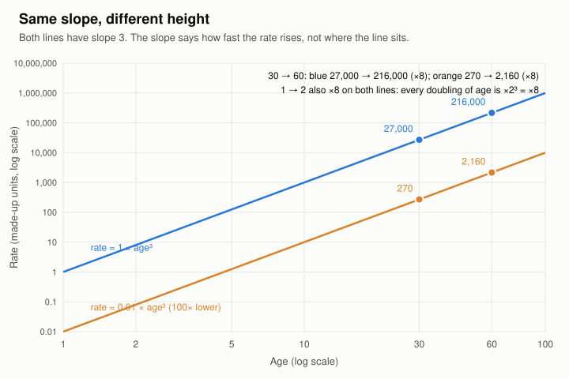
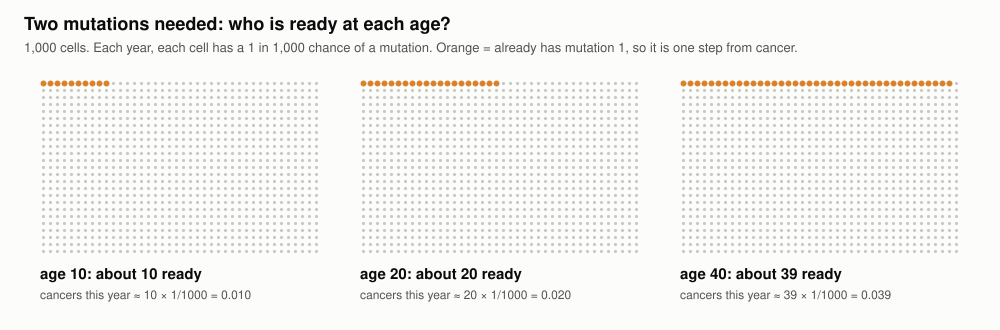
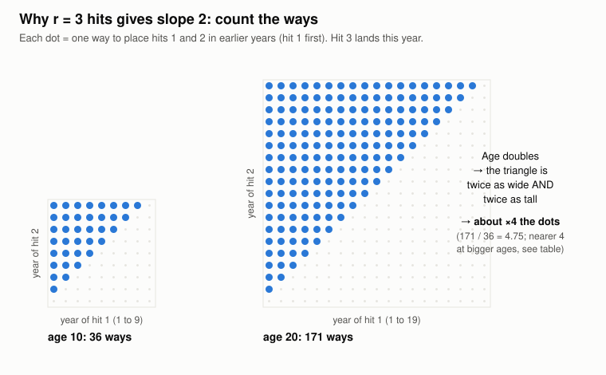
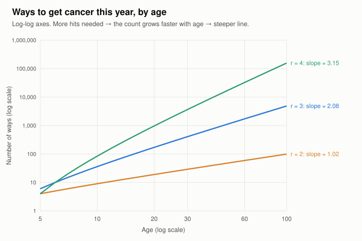
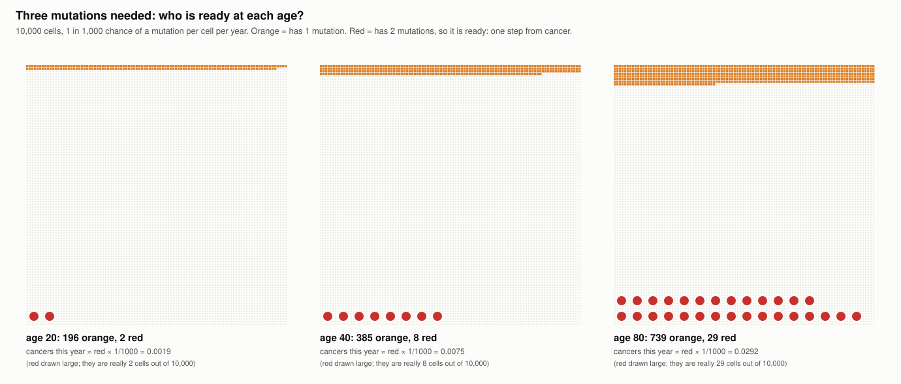
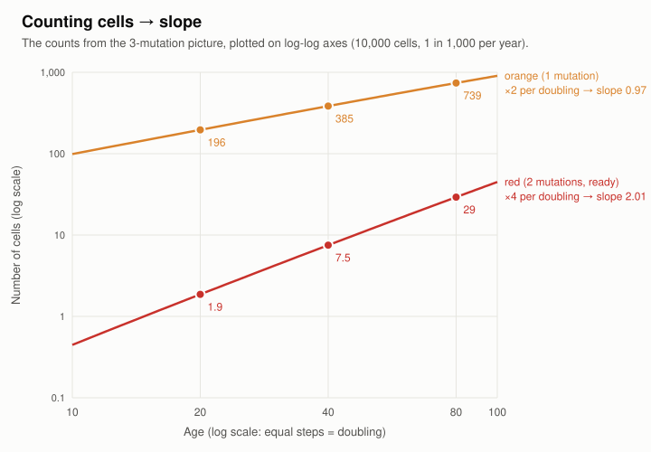
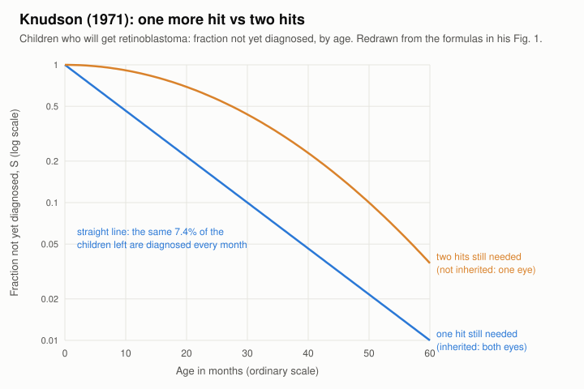
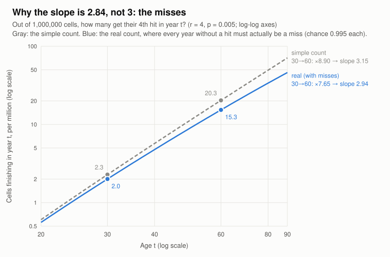

# How r (hits) relates to the log-log slope

Teaching pictures from 2026-11-10. They're made by `web/learn-slope.js`
(`node learn-slope.js` from `web/` redraws them and prints every number below).

## 1. The slope gives the ratio, not the height



**Slope k means: each time age doubles, the rate is multiplied by 2^k.**

| slope | age doubles → rate × |
|---|---|
| 0 | 1 (flat) |
| 1 | 2 |
| 2 | 4 |
| 3 | 8 |
| 6 | 64 |

Both lines in the picture have slope 3:

| age | blue (1 × age³) | orange (0.01 × age³) |
|---|---|---|
| 1 | 1 | 0.01 |
| 2 | 8 | 0.08 |
| 30 | 27,000 | 270 |
| 60 | 216,000 | 2,160 |

Every doubling multiplies by 8: 1 → 2, 30 → 60, on both lines. But the orange
line is 100 times lower everywhere.

**So the slope alone can't tell you the rate.** You need one more number, the
height, such as the rate at any one age. In the model the height comes from N
(how many cells) and p (how likely each hit is). The slope comes from r.

## 2a. Start here: 2 mutations needed



- A cell becomes cancer when it gets **mutation 2**, but only if it already
  has **mutation 1**.
- So the only cells that can turn into cancer **this year** are the orange
  ones.
- Older body → more years for mutation 1 to happen → more orange cells.
- Twice the age gives about twice the orange cells, so about twice the cancer
  this year.
- Doubling gives ×2, which is **slope 1**.

| age | cells with mutation 1 (of 1,000) | cancers this year |
|---|---|---|
| 10 | about 10 | 10 × 1/1000 = 0.010 |
| 20 | about 20 | 0.020 |
| 40 | about 39 | 0.039 |

## What a "way" means (added 2026-11-12, Cameron's question)

A **way** is one exact list of **which years** a cell got its hits.

Example: a cell needs 2 hits and gets hit 2 in year 5. Hit 1 could have been in
year 1, 2, 3 or 4, so there are **4 ways** (H = hit, · = no hit):

```
year:    1  2  3  4  5
way A:   H  ·  ·  ·  H
way B:   ·  H  ·  ·  H
way C:   ·  ·  H  ·  H
way D:   ·  ·  ·  H  H
```

Each way is one full year-by-year story. Its chance is the chance of every
year in the row: 2 hits (0.005 each) **and** 3 misses (0.995 each):

- one way: 0.005 × 0.005 × 0.995 × 0.995 × 0.995 = 0.0000246
- all 4 ways: 4 × 0.0000246 = 0.0000985

The simple formula only multiplies the H's (4 × 0.005² = 0.0001) and forgets
the "·" years. Each dot in figure 2 is one way.

## 2b. Why r hits gives slope r − 1: count the ways

A cell gets cancer **in year t** when its last hit (hit r) lands in year t. The
other r − 1 hits must have landed **earlier**, one per year, in order.

Each way of placing the earlier hits has the same chance (about p^r when p is
small), so:

```
rate this year  ≈  (number of ways to place the earlier r−1 hits)  ×  p^r
                    grows with age, sets the SLOPE                   same at every age, sets the HEIGHT
```

**r = 2:** only hit 1 is earlier. At age 10 it can be in any of years 1–9, so
there are 9 ways. At age 20 there are 19 ways. Doubling age about doubles the
ways, so the slope is about 1.

**r = 3:** hits 1 and 2 are earlier, with hit 1 first. Each dot is one way:



When age doubles, the triangle gets twice as wide **and** twice as tall, so it
holds about 2 × 2 = 4 times as many dots. That's slope 2.

- With r − 1 earlier hits, each one adds its own "twice as many choices", so
  the total is 2 × 2 × … (r − 1 times) = 2^(r−1).
- That makes the slope **r − 1**.

The count is "pick r − 1 years out of t − 1", written C(t − 1, r − 1):

| r | ways at 30 | ways at 60 | ratio | slope = log2(ratio) | simple rule r − 1 |
|---|---|---|---|---|---|
| 1 | 1 | 1 | 1.00 | 0.00 | 0 |
| 2 | 29 | 59 | 2.03 | 1.02 | 1 |
| 3 | 406 | 1,711 | 4.21 | 2.08 | 2 |
| 4 | 3,654 | 32,509 | 8.90 | 3.15 | 3 |
| 5 | 23,751 | 455,126 | 19.16 | 4.26 | 4 |
| 7 | 475,020 | 45,057,474 | 94.85 | 6.57 | 6 |

Check two by hand:
- r = 2 at age 30 is 29 ways (years 1–29).
- r = 3 at age 30 is 29 × 28 / 2 = 406.



### Why the ratios are a bit above 2, 4, 8

"Twice as many choices" is only roughly true at small ages. Going from age 10
to 20, the earlier years go from 9 to 19, which is a bit more than double. The
gap shrinks as ages grow (r = 3):

| ages | ways | ratio |
|---|---|---|
| 10 → 20 | 36 → 171 | 4.750 |
| 30 → 60 | 406 → 1,711 | 4.214 |
| 100 → 200 | 4,851 → 19,701 | 4.061 |
| 1000 → 2000 | 498,501 → 1,997,001 | 4.006 |

Counting ways alone gives a slope a little **above** r − 1 (3.15 for r = 4).
Our exact model gives 2.84, a little **below**. Something else pulls it down:
cells that already got cancer drop out, and each person has 100 cells. That's
topic 3.

## r = 1: the flat case

With 1 hit there are no earlier hits to place, so there's 1 way at every age.
The rate is the same at every age: slope 0, a flat line. This is how Armitage &
Doll ruled out "one hit" (see `notes/armitage-doll-my-notes.md`, item 1).

### Why 39 and not 40? (Cameron's question)

It isn't random chance. These are average (expected) counts, not a simulation.
A cell that's already orange can't "get mutation 1" again, so only the gray
cells can turn orange, and every year there are a few fewer gray cells:

| year | gray cells at the start | new orange this year (gray × 1/1000) | orange so far |
|---|---|---|---|
| 1 | 1000 | 1.000 | 1.00 |
| 2 | 999 | 0.999 | 2.00 |
| 3 | 998.0 | 0.998 | 3.00 |
| 40 | | | 39.23 |
| 80 | | | 76.92 |

The shortfall grows with age: 40 → 39.2, 80 → 76.9. So from 40 to 80 the
orange count rises ×1.96 instead of ×2, and the line bends slightly flatter.
This is item 4 in `notes/armitage-doll-my-notes.md` ("the line flattens") and
one of the reasons our exact slope is 2.84 instead of 3.

## 2c. Three mutations needed



10,000 cells, 1 in 1,000 chance of a mutation per cell per year. Now a cell is
ready (one step from cancer) only when it has **2** mutations (red).

| age | orange (1 mutation) | red (2 mutations, ready) | cancers this year = red × 1/1000 |
|---|---|---|---|
| 20 | 196 | 1.87 | 0.00187 |
| 40 | 385 | 7.51 | 0.00751 |
| 80 | 739 | 29.2 | 0.0292 |

**Which number does ×4 apply to?**

| when age doubles (20 → 40) | × |
|---|---|
| orange count | ×1.96 (about 2) |
| **red count** | **×4.02 (about 4)** |
| **cancers this year** | **×4.02**, the same as red, because it's always red × 1/1000 |

**Why red gets ×4:** red ≈ orange × (fraction of orange cells that have also
got mutation 2 by now).

| age | orange | fraction that also got mutation 2 (red ÷ orange) | red |
|---|---|---|---|
| 20 | 196 | 0.0095 (about 1%) | 1.87 |
| 40 | 385 | 0.0195 (about 2%) | 7.51 |
| 80 | 739 | 0.0395 (about 4%) | 29.2 |

Doubling the age doubles **both** the orange count **and** the fraction, so red
goes ×2 × 2 = ×4. That's slope 2.

40 → 80 gives ×3.89, a bit under 4, for the same reason as "39 instead of 40":
gray cells get used up.

## 2d. From counting red cells to the slope



- Plot the red count against age on log-log axes and you get a straight line.
- On these axes, each step right is a doubling of age, and each step up is a
  ×10.
- The slope counts how many "×2"s you get per doubling of age:

| per doubling of age | count multiplied by | = 2 to the power… | slope |
|---|---|---|---|
| orange | ×2 | 2¹ | 1 |
| red | ×4 = ×2 × 2 | 2² | 2 |

**Cancers this year = red × 1/1000.** Multiplying by a fixed number moves the
line up or down (idea 1) but doesn't change its slope. So the cancer-rate line
has the **same slope as the red line**: 2. Counting red cells **is** measuring
the slope of the cancer rate.

**4 mutations needed:** ready cells have 3 mutations. Each doubling of age gives
×2 (more cells with mutation 1) × 2 (more time for mutation 2) × 2 (more time
for mutation 3) = ×8 = 2³. That's slope 3.

**General rule:** r mutations needed → ready cells have r − 1 → ×2 that many
times → slope r − 1.

## The chain (going backward from data)

```
rate ×2^k when age doubles  →  slope = k  →  mutations = k + 1
   ×32 = 2^5                →  slope 5    →  6 mutations
   ×64 = 2^6                →  slope 6    →  7 mutations
```

The power of 2 **is** the slope, with no −1 there. The ±1 shows up only between
slope and mutations: going forward, slope = r − 1; going backward,
r = slope + 1. (A mix-up to watch for, from the quiz on 2026-11-10.)

## 3. Knudson (1971): the same idea, for children



Redrawn from the two formulas in his Fig. 1 caption (p. 823). This isn't his
data. S = fraction of the children (who will get retinoblastoma) not yet
diagnosed.

| age (months) | one hit still needed: share of remaining diagnosed next month | two hits needed: share next month |
|---|---|---|
| 10 | 7.4% | 1.9% |
| 20 | 7.4% | 3.7% |
| 40 | 7.4% | 7.2% |

- **One hit:** the same share every month, so a flat rate: r = 1, slope 0.
- **Two hits:** about ×2 per doubling of age: r = 2, slope 1.

## 4. Why our exact slope is 2.84, not 3



**Example (the picture):** out of 1,000,000 cells, how many get their 4th hit
in year t?

| age | simple count, C(t−1, 3) × 0.005⁴ × 10⁶ | × misses 0.995^(t−4) | real |
|---|---|---|---|
| 30 | 2.28 | × 0.878 | 2.00 |
| 60 | 20.3 | × 0.755 | 15.3 |
| 30 → 60 | ×8.90 (slope 3.15) | | ×7.65 (slope 2.94) |

The fit uses ages 25–85, and the oldest ages lose the most to misses, so over
the whole range the slope ends at 2.84.

**All the steps, measured.** Start from the simple formula (slope exactly 3)
and add one detail of our model at a time, refitting the slope each time:

| step | slope | change |
|---|---|---|
| simple formula at the middle age | 3.000 | |
| + average over each 5-year group | 2.994 | −0.006 |
| + whole years (count the ways) | 3.094 | **+0.100** |
| + every other year must be a miss | 2.842 | **−0.252** |
| + 100 cells, people drop out (full model) | 2.841 | −0.001 |

**The big one: "every other year must be a miss."** For a cell's last hit to
land in year t, the cell must get its r hits in r particular years **and no
hit in any of the other years**. Otherwise it would have finished earlier. The
simple formula forgets that, but each "miss" has chance 0.995:

| age | other years | chance they're all misses (0.995^years) |
|---|---|---|
| 30 | 26 | 0.878 |
| 60 | 56 | 0.755 |
| 80 | 76 | 0.683 |

Older ages lose more, so the line tilts down. That's the same effect as
"39 instead of 40" in section 2a.

**Correction (2026-11-12):** on 2026-11-10 I (Claude) said the 100 cells and
people dropping out were two more reasons. Measured, they change the slope by
only 0.001. The rate is divided by person-years of people still at risk, so
dropouts leave the numerator and the denominator together.
